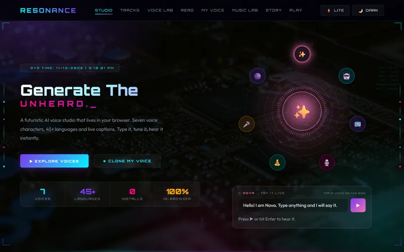
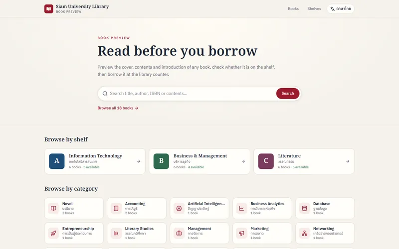
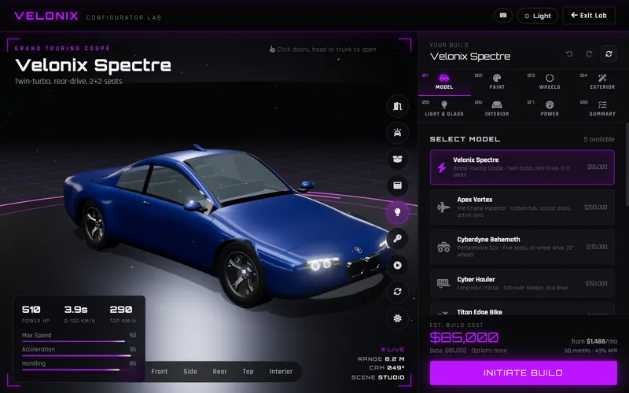
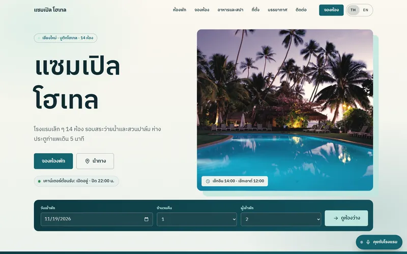
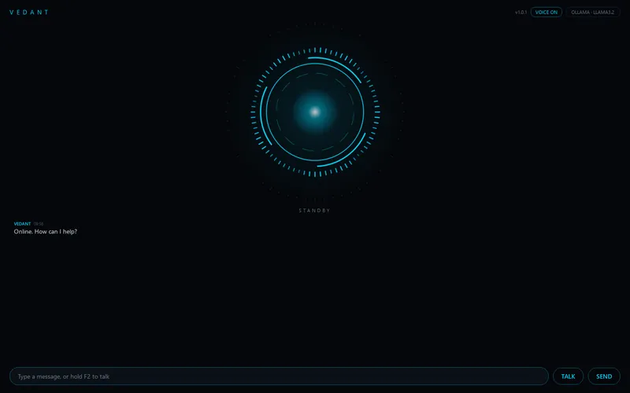
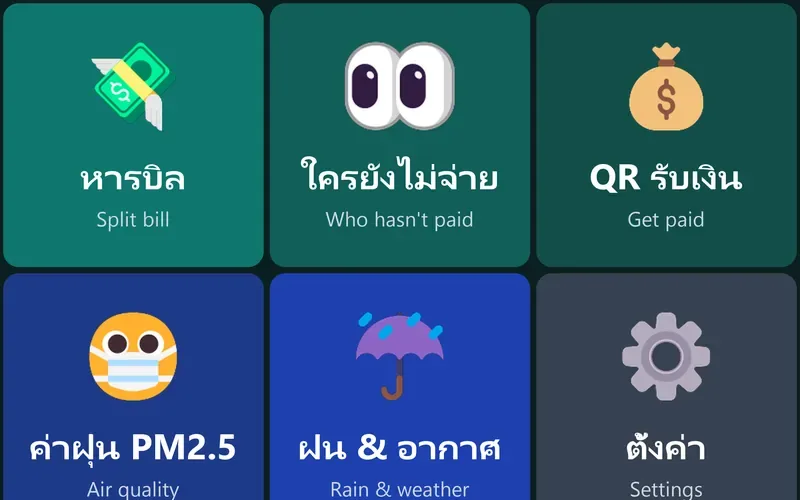
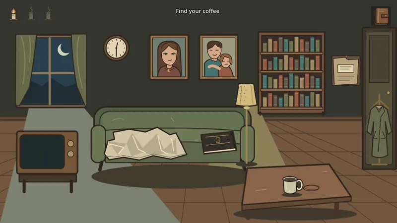
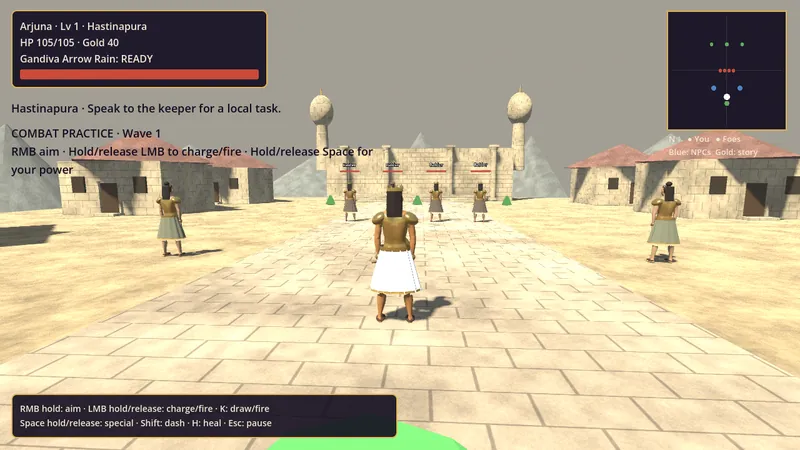

<a href="https://sudasun.vercel.app">
  <picture>
    <source media="(prefers-color-scheme: dark)" srcset="assets/header-dark.svg">
    
  </picture>
</a>

  <a href="https://sudasun.vercel.app"><b>Portfolio</b></a> &nbsp;·&nbsp;
  <a href="https://sudasun.vercel.app/assets/resume.pdf">Resume (PDF)</a> &nbsp;·&nbsp;
  <a href="https://www.linkedin.com/in/sudarsun-020298348/">LinkedIn</a> &nbsp;·&nbsp;
  <a href="mailto:sudarsun78@gmail.com">sudarsun78@gmail.com</a>

I'm a B.Sc. Information Technology student at Siam University in Bangkok, graduating in May 2027. I design, build and test my own projects from start to finish: websites, web apps, desktop tools and games. I'm looking for a **front-end internship or junior role from January 2027**, in Bangkok or remote.

## Selected work

<table>
  <tr>
    <td width="50%" valign="top">
      
      <h3>Resonance</h3>
      A voice studio in the browser: type text, pick a voice and hear it read aloud with live captions. 
      <code>JavaScript</code> <code>Web Speech API</code> 
      <a href="https://resonancesun.netlify.app/">Live</a> · <a href="https://github.com/SUDARSUN-24/Resonance">Code</a>
    </td>
    <td width="50%" valign="top">
      
      <h3>Siam Library</h3>
      Book previews for my university library: read a sample, then see if the book is on the shelf and where. 
      <code>Next.js</code> <code>TypeScript</code> <code>Prisma</code> <code>PostgreSQL</code> 
      <a href="https://siam-library.vercel.app/">Live</a> · <a href="https://github.com/SUDARSUN-24/siam-library">Code</a>
    </td>
  </tr>
  <tr>
    <td width="50%" valign="top">
      
      <h3>Velonix Customs</h3>
      A 3D vehicle showroom: rotate five vehicles, customise one in the configurator and rev its engine. 
      <code>JavaScript</code> <code>Three.js</code> 
      <a href="https://velonixsun.vercel.app/">Live</a> · <a href="https://github.com/SUDARSUN-24/Velonix">Code</a>
    </td>
    <td width="50%" valign="top">
      
      <h3>Sample Hotel</h3>
      A Thai/English hotel site with a room booking backend and a voice concierge. 
      <code>JavaScript</code> <code>Netlify Functions</code> 
      <a href="https://sample-hotel-demo.netlify.app/">Live</a> · <a href="https://github.com/SUDARSUN-24/sample-hotel">Code</a>
    </td>
  </tr>
  <tr>
    <td width="50%" valign="top">
      
      <h3>Vedant</h3>
      A voice AI assistant for Windows: talk or type, hear it answer, and let it set reminders and open apps. 
      <code>Python</code> <code>PySide6</code> <code>174 tests</code> 
      <a href="https://github.com/SUDARSUN-24/vedant-assistant">Code</a>
    </td>
    <td width="50%" valign="top">
      
      <h3>Khun Chuay</h3>
      A LINE bot for Thailand: split bills with PromptPay QR codes and get PM2.5 and rain alerts. 
      <code>JavaScript</code> <code>Cloudflare Workers</code> 
      <a href="https://github.com/SUDARSUN-24/khun-chuay">Code</a>
    </td>
  </tr>
</table>

Also: [Sample Cafe](https://sample-cafe-demo.netlify.app/), a Thai/English cafe site template with table booking and a staff dashboard ([code](https://github.com/SUDARSUN-24/sample-cafe)).

## Games in Godot 4

<table>
  <tr>
    <td width="33%" valign="top"> <b>Whispers of the River</b> First-person horror · team lead</td>
    <td width="33%" valign="top"> <b>Buried at Isle Wood</b> 1920s detective point-and-click</td>
    <td width="33%" valign="top"> <b>Mahabharat</b> Action RPG</td>
  </tr>
</table>

The game repos are private. You can see more on my <a href="https://sudasun.vercel.app">portfolio</a>, and I can give a demo on request.

## Tools

            

## Now

Learning React and TypeScript by building an animated front-end project. I also speak English, Thai, Nepali and Hindi.
